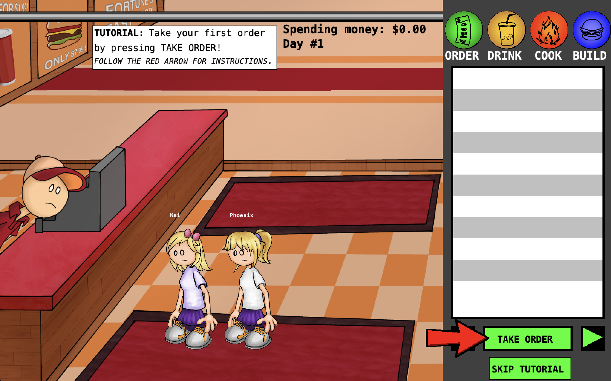
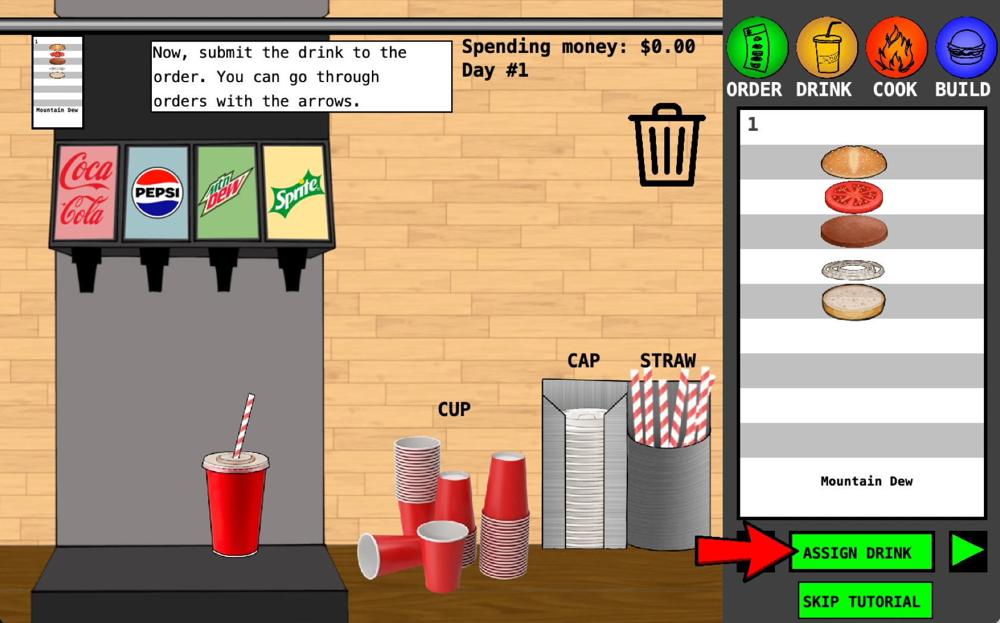
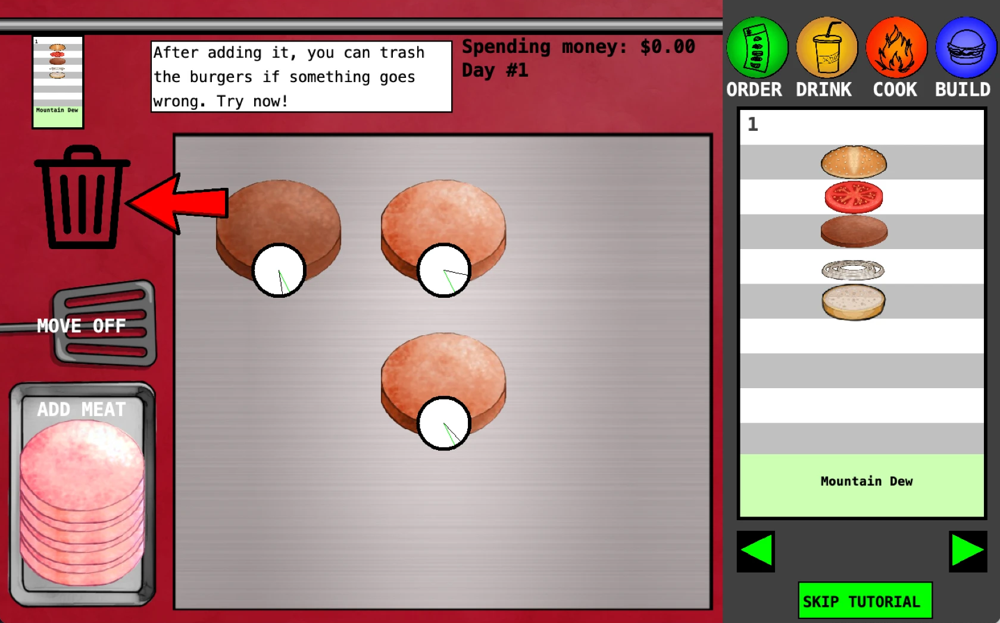
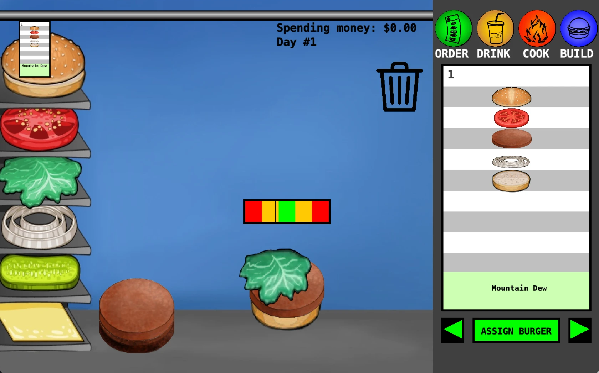
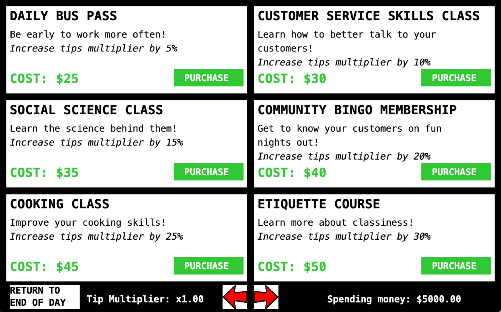
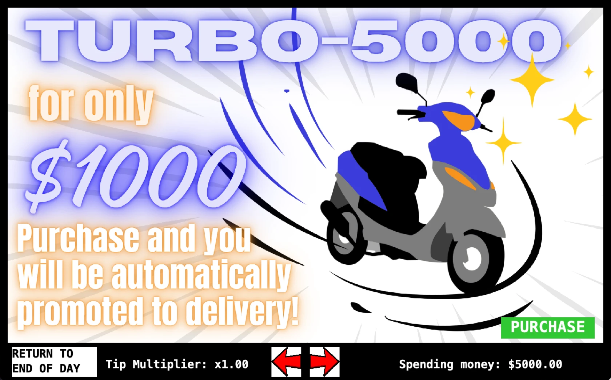
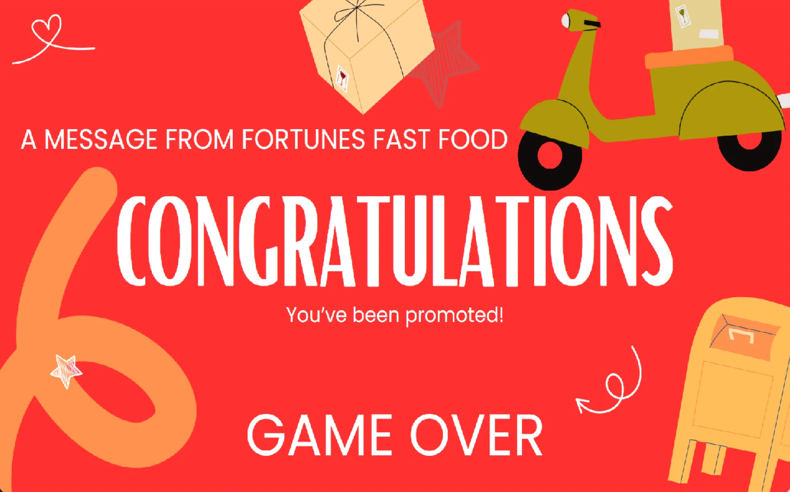

# Fortune's Fast Food 🍔

A burger-shop management game written in **Java** (Swing). You work the counter, taking and fulfilling orders as quickly and accurately as you can, earn tips, and buy upgrades to get promoted.

Built by **Emilee Zhang** and **Nevetha Arullinkam** (May to June 2025).

> **All artwork is hand-drawn and every part of the game was built from scratch, with no AI-generated art or code.**

## How the game works
1. **Take orders.** Customers walk up with a burger and sometimes a drink, and orders appear on your ticket menu.
2. **Cook.** Place burger patties on the stove and pull them off before they burn.
3. **Assemble.** Stack the toppings in the right order with a timing minigame.
4. **Pour drinks.** Fill cups for orders that need one.
5. **Hand it in.** Your tip depends on how accurate the burger and drink are and how fast you were, with a time bonus only for good orders, so rushing a bad burger doesn't pay.
6. **Upgrade.** Between days, spend your earnings on upgrades such as a bus pass, a cooking class or an etiquette course. Each one boosts your tip multiplier, from 5% up to 30%. Save up for the final $1000 upgrade, a scooter that gets you promoted to delivery and ends the game.

A built-in tutorial walks new players through the first order.

## Screenshots

**Taking orders, with the built-in tutorial**


**Drink station**


**Cook station**


**Building the burger** (a timing minigame for stacking toppings)


**Upgrades between days**


**The final upgrade: buy the scooter and get promoted to delivery**


**The ending: you've been promoted!**


## Under the hood
About 3,000 lines of Java across 18 classes, with the game loop on its own thread:

| Area | Classes |
|---|---|
| Game loop & window | `GameFrame`, `GamePanel` (a `JPanel` that implements `Runnable`) |
| Stations | `OrderStation`, `CookStation`, `AssemblyStation`, `DrinkStation`, `StationMenu` |
| Orders & scoring | `Order`, `TicketMenu`, `Food`, `Burger`, `Drink` |
| Progression | `Upgrades`, `Player`, `Minigame` |
| Tutorial & sound | `Instructions`, `Sound` |

Scoring is calculated in `Order.java`: topping placement and count, how well the meat is cooked, whether the drink is right, and the time taken.

## Run it
Requires Java (JDK 8 or newer) and a screen at least **1440 × 900** pixels, since the game window has a fixed size and can't be resized. On a smaller screen, parts of the game will be cut off. From the project folder (the one containing the images and `src`):

```bash
javac -d bin src/*.java
java -cp bin FortuneFastFood
```

The images and sounds load by relative path, so run these from the project's top-level folder. On Windows you can also double-click `runMe.bat`.

## Credits
Made by Emilee Zhang and Nevetha Arullinkam. We wrote the game ourselves and drew all the artwork by hand. The only outside help in the code is the looping-music logic in `Sound.java`, adapted from a YouTube tutorial, and a number-formatting tip from StackOverflow in `Order.java`. Inspired by *Papa's Pizzeria*.

**Audio:** the sound files (`background.wav`, `bounce.wav`) are third-party and not our own work; their original sources were not recorded.
